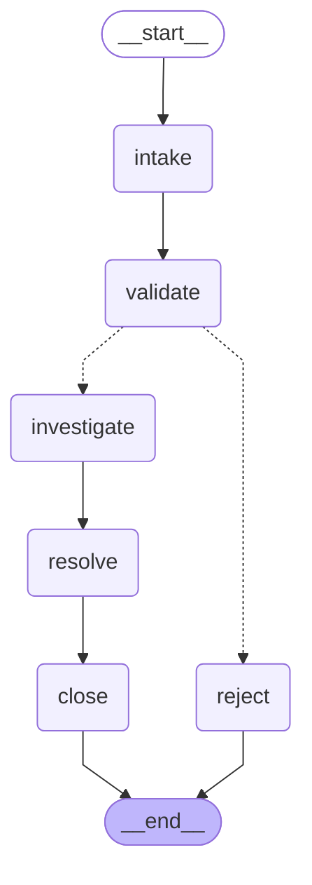

# Lab Proof: NormalObjects Complaint Processor

**Entry point for the reviewer.** 

| File | What it is |
|---|---|
| `lab_proof.md` | This proof |
| `normalobjects_langgraph_draft.ipynb` | Full lab: steps 1-6, extensions, failure tests |
| `normalobjects_langgraph.py` | The notebook's graph as a runnable script and importable module (same state, lore, nodes, prompts), plus the parallel graph and SQLite persistence |
| `app.py` | NormalObjects Complaint Desk: Gradio web app on top of `normalobjects_langgraph.py` |

## 1. What I built

A strict LangGraph state machine. Every complaint moves through fixed nodes. The only knowledge source is the
`LORE` dict (one entry per category). Routing after validation is a pure-Python rule, not an LLM decision.



| Node | LLM? | Writes to state |
|---|---|---|
| `intake` | yes | `category` |
| `validate` | no (rules) | `is_valid`, `validation_reason` |
| `investigate` | yes, lore-only prompt | `evidence`, `evidence_source`, `investigation` |
| `resolve` | yes, sees only the findings | `resolution` |
| `close` / `reject` | no (template) | `closure`, `status` |

Key code (routing + the grounded step):

```python
def route_after_validation(state: ComplaintState) -> Literal["investigate", "reject"]:
    """Conditional edge: valid complaints get investigated, invalid ones get rejected."""
    if state["is_valid"]:
        return "investigate"
    return "reject"

def investigate_node(state: ComplaintState) -> ComplaintState:
    """Step 3: Investigate - gather information from the lore (the only allowed source)."""
    print("\n[INVESTIGATE] Looking up lore...")

    category = state["category"]
    lore = LORE[category]                    # the retrieval / tool step
    source = f"LORE['{category}']"

    investigation_prompt = f"""You are a strict NormalObjects investigator.
Answer the complaint using ONLY the lore below. Do not add any fact that is not in the lore.
If the lore does not answer the complaint, reply exactly: "The lore does not cover this."

Lore ({category}): {lore}

Complaint: {state["complaint"]}

Findings (max 2 sentences):"""

    response = llm.invoke([HumanMessage(content=investigation_prompt)])
    findings = response.content.strip()

    new_state = {
        **state,
        "evidence": lore,
        "evidence_source": source,
        "investigation": findings,
        "workflow_path": state.get("workflow_path", []) + ["investigate"],
        "status": "investigated",
    }

    print(f"[INVESTIGATE] Evidence source: {source}")
    print(f"[INVESTIGATE] Evidence text  : {lore}")
    print(f"[INVESTIGATE] Findings       : {findings}")
    return new_state
```

## 2. Query

> The Downside Up portal opens at different times each day. How do I predict when?

## 3. Evidence (workflow path + log lines + lore used)

- **Workflow path:** `intake → validate → investigate → resolve → close`
- **Category:** `portal` · **Validation:** Category 'portal' is in VALID_CATEGORIES and has a LORE entry.
- **Evidence source:** `LORE['portal']`
- **Lore text used (verbatim):** "Portals open when the barrier between worlds is weak. Their timing follows electrical activity, not the clock."

Log lines captured during the run:

```text
[INTAKE] Processing complaint...
[INTAKE] Categorized as: portal

[VALIDATE] Checking complaint against rules...
[VALIDATE] valid=True | Category 'portal' is in VALID_CATEGORIES and has a LORE entry.

[INVESTIGATE] Looking up lore...
[INVESTIGATE] Evidence source: LORE['portal']
[INVESTIGATE] Evidence text  : Portals open when the barrier between worlds is weak. Their timing follows electrical activity, not the clock.
[INVESTIGATE] Findings       : The lore states that portals open when the barrier between worlds is weak and that their timing follows electrical activity, not the clock. Therefore, predicting the exact time for the Downside Up portal requires monitoring electrical activity rather than relying on a set schedule.

[RESOLVE] Writing resolution...
[RESOLVE] Resolution: The timing of the Downside Up portal is influenced by electrical activity rather than a fixed schedule, so to predict its opening, you'll need to monitor electrical fluctuations instead of relying on the clock.

[CLOSE] Closing complaint...
[CLOSE] Status: closed
```

## 4. Final output

```text
✅ Complaint closed.
Category  : portal
Resolution: The timing of the Downside Up portal is influenced by electrical activity rather than a fixed schedule, so to predict its opening, you'll need to monitor electrical fluctuations instead of relying on the clock.
Evidence  : LORE['portal'] → "Portals open when the barrier between worlds is weak. Their timing follows electrical activity, not the clock."
```

## 5. Trace (which claim comes from which lore line?)

Each sentence of the findings and the resolution, matched to the lore sentence it shares the most content words with.

| Field | Claim | Lore line | Shared terms | Verdict |
|---|---|---|---|---|
| investigation | The lore states that portals open when the barrier between worlds is weak and that their timing follows electrical activity, not the clock. | Portals open when the barrier between worlds is weak. | barrier, between, open, portal, weak, world | supported (shared terms) |
| investigation | Therefore, predicting the exact time for the Downside Up portal requires monitoring electrical activity rather than relying on a set schedule. | Their timing follows electrical activity, not the clock. | activity, electrical | supported (shared terms) |
| resolution | The timing of the Downside Up portal is influenced by electrical activity rather than a fixed schedule, so to predict its opening, you'll need to monitor electrical fluctuations instead of relying on the clock. | Their timing follows electrical activity, not the clock. | activity, clock, electrical, timing | supported (shared terms) |

**Reading:** a claim is grounded when its *meaning* is in the lore line. The shared-terms column is only a pointer
for the reviewer, not proof (it can't see synonyms, and advice such as "monitor" is derived, not quoted).

The invalid path leaves its own evidence. For *"Why the mother at gilmore girls constantly have ups and downs in her mood?"*:
path `intake → validate → reject`, category `other`, investigation `''`
(nothing generated), message: `❌ Complaint rejected. Reason: Rule 2 failed: category 'other' is not one of ['portal', 'monster', 'psychic', 'environmental']. NormalObjects only processes Downside Up complaints.`

## 6. Failure or limitation

**Where can the system produce a plausible but unsupported answer?** When a complaint spans **more than one
category**. Intake picks one category with one LLM call, validation only checks that the category is *allowed*
(not that it *covers the whole question*), and the investigator then fills the gap.

**Observed failure (failure-case test `mixed`):**

> When El uses her powers near the portal, the lights flicker and she gets a nosebleed. Why?

- Category: `psychic` → only `LORE['psychic']` was used: "Psychic power drains the user's energy. Bigger or heavier objects need more energy, and nosebleeds are a warning sign."
- Topics from the complaint that the answer talks about but this lore never mentions: **flicker, light, portal**

| Claim in the answer | Closest line in `LORE['psychic']` | Verdict |
|---|---|---|
| El's use of her psychic powers near the portal likely drains her energy, causing the lights to flicker as a result of the energy fluctuation. | Psychic power drains the user's energy. | ⚠️ talks about flicker, light, portal: not in this lore |
| The nosebleed she experiences serves as a warning sign of this energy drain. | Bigger or heavier objects need more energy, and nosebleeds are a warning sign. | backed by lore line |
| El's powers near the portal are causing energy fluctuations, which lead to the flickering lights and her nosebleed as a warning sign of energy drain. | Bigger or heavier objects need more energy, and nosebleeds are a warning sign. | ⚠️ talks about light, portal: not in this lore |
| It's advisable for her to limit her use of powers in that area. | Psychic power drains the user's energy. | backed by lore line |

The complaint still ended as **`closed`** with a confident answer. The lore needed for those topics exists
(`LORE['environmental']`: lights flicker near creatures; `LORE['portal']`), but it was never retrieved, so the model
connected the dots itself. The graph shape guarantees a lore lookup, **not** the right one.

**Second check, prompt injection:** The prompt-injection complaint was categorized as `other` and **rejected** (`intake → validate → reject`). The classifier was not fooled this time, but nothing in the rules *guarantees* that: the category still comes from a single LLM call.


## 7. LangGraph vs. one LLM call

| | LangGraph | One LLM call |
|---|---|---|
| Same answer every run? | Path, category and evidence: yes (re-run matched: True). Wording: almost (temp 0) | No guarantee; two creative-chain runs identical: False |
| Invalid complaint rejected? | Yes, `reject` node with the failed rule | No, it answered anyway (excerpt below) |
| Path visible? | Yes: `workflow_path` + node logs | No |
| Source of each claim? | `evidence_source` + verbatim `evidence` | Unknown (model memory) |
| Best for which client case? | Audited complaint/claims processes | Brainstorming, drafting |

One LLM call, same query (excerpt): "To predict when the Downside Up portal opens, you can follow these steps:<br><br>1. **Historical Data**: Gather data on the opening times of the portal over a period of time. Look for patterns or trends in the times it opens.<br><br>2. **Identify Patterns**: Analyze the data for any recurring patterns. For example, does it open at similar times on certain days of the week? Are there specific intervals between..."

One LLM call, invalid complaint (excerpt): "In "Gilmore Girls," Lorelai Gilmore, the mother, experiences a range of emotional ups and downs due to several factors:<br><br>1. **Personal History**: Lorelai's challenging relationship with her own parents, particularly her mother, Emily, has left her with unresolved issues that often resurface. This co..."

## 8. Grounding self-review (prompt discipline)

**Three grounding risks:** (1) a wrong category from intake sends the wrong lore to the investigator; (2) `resolve`
sees only the findings, so drift in the findings is repeated, and "advice" can sound like fact; (3) lore entries are
one or two sentences, so questions outside them invite gap-filling.

**Two trace checks:** (1) closed → path ends `investigate → resolve → close` and `evidence_source == LORE[category]`,
every claim maps to a lore line (table in section 5); (2) rejected → path ends in `reject` and `investigation` /
`resolution` are empty.

**One simplification:** `close` and `reject` are templates with no LLM, so the final message cannot add claims.

**Verification:** `evidence` + `evidence_source` in the final state, the `[INVESTIGATE] Evidence source` log line,
and the claim → lore table tie the answer to the source.

## 9. Web app: NormalObjects Complaint Desk (Extension E5)

`app.py` puts the same graph behind a local Gradio interface, so a reviewer can submit a complaint and inspect the
evidence without reading code. It imports the compiled graph from `normalobjects_langgraph.py`, so it follows the
same path and uses the same lore as the run above.

**Run:** `python app.py`, then open the local URL it prints.  It needs
`OPENAI_API_KEY` in `.env` and runs locally only (no public share link).

| Feature | What it shows | Why it matters for grounding |
|---|---|---|
| Live step lights | One light per node (`intake`, `validate`, `investigate`, `resolve`, `close`, `reject`). It flickers while the node runs and stays lit when done; skipped steps go dark | The workflow path is visible while it happens, from `app.stream(..., stream_mode=["tasks", "values"])` |
| Case file | Path, validation reason, `evidence_source`, the lore text verbatim, findings, resolution, CLOSED / REJECTED stamp | Every answer is shown next to the only source it may use. A rejected case shows no answer at all |
| Case files history | Every processed complaint with category, status, path and evidence source | Earlier answers stay traceable after a restart (SQLite `complaints.db`, git-ignored) |
| Multi-category mode | Runs the parallel investigation (E1), one light per category | Makes the section 6 limitation easy to try: each finding is labeled with its `LORE[...]` source |

The app also retries the investigate step up to 3 times on API timeouts (Extension E2) and shows an error card
instead of crashing. The theme (alphabet-wall lights, a demogorgon on the loading bar) is fan-made for this lab and
not affiliated with Netflix.

## Submission checklist

- [x] No API keys or `.env` committed (`.env` and `complaints.db` are in `.gitignore`)
- [x] Only lab files
- [x] `lab_proof.md` is the entry point
